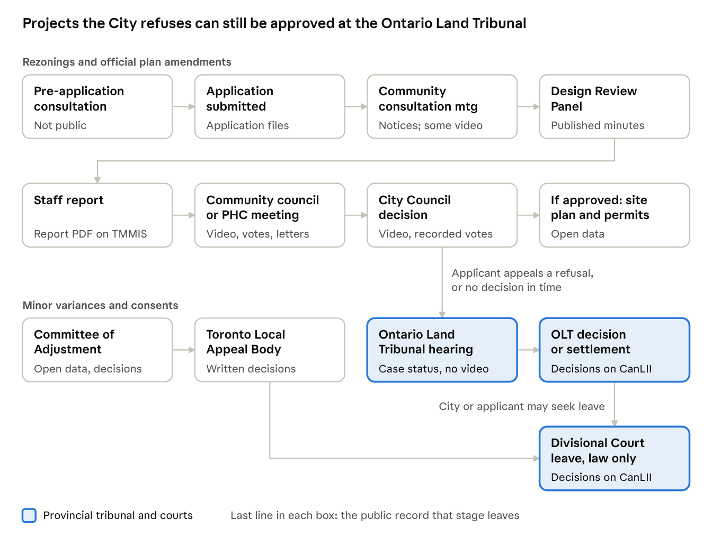
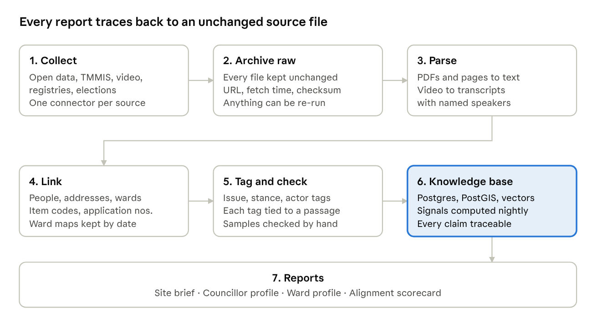
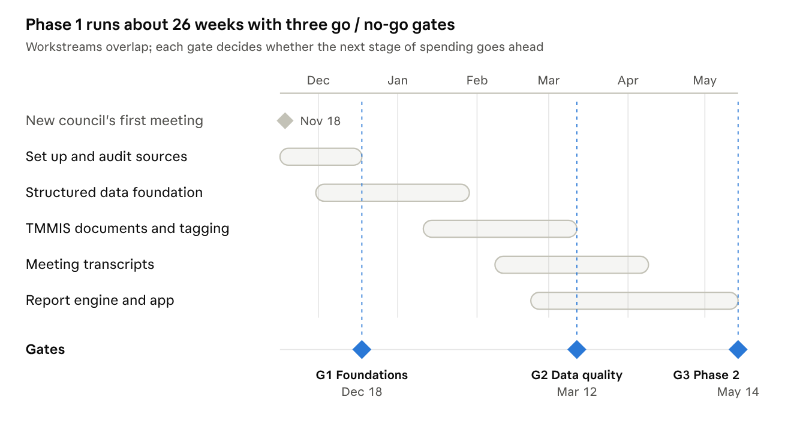

# Political Intelligence Platform — Phase 1 Plan: Toronto Housing & Land Development

Nov 6, 2026 · @Kiel O'Sullivan

## Summary

Phase 1 builds a working political-intelligence product for one city and
one domain: **housing and land development in the City of Toronto**,
from the 2018 move to 25 wards to the present. Over about six months it
turns open data, council records and meeting video into cited briefs on
a site, a ward, a councillor or an issue.

**Why housing and not all of real estate:** housing and land development
is where politics most directly decides outcomes. Council votes,
community councils, Committee of Adjustment decisions, community
submissions and mayoral powers all act on it. Commercial leasing or
property tax would add data without adding much political signal.
Commercial and mixed-use development is still in scope wherever it goes
through the planning process.

**Phase 1 is done when:**

- Every recorded housing-related vote, development application and
  Committee of Adjustment application since December 2018 is loaded and
  linked to its ward and councillor.

- Issue tags and stance tags pass a hand-checked accuracy bar (targets
  in the roadmap section).

- Recording quality is measured for every Toronto meeting venue, so the
  option of installing our own recording equipment can be decided on
  evidence.

- The data model and issue taxonomy can take a second city or a second
  issue area without being redesigned.

Sales and go-to-market work is deferred. Your two decades in real estate
investment and development set the initial product requirements, so
Phase 1 spends its effort on data infrastructure.

## Scope

Phase 1 covers one city, one issue area and three kinds of user.
Everything else waits for Phase 2.

| Dimension        | In Phase 1                                                                                                                                                                                                                                                  | Deferred                                                                                                                          |
|------------------|-------------------------------------------------------------------------------------------------------------------------------------------------------------------------------------------------------------------------------------------------------------|-----------------------------------------------------------------------------------------------------------------------------------|
| Geography        | City of Toronto, all 25 wards                                                                                                                                                                                                                               | GTA municipalities, Ottawa, other provinces                                                                                       |
| Government level | City Council, Planning and Housing Committee, the 4 community councils, Committee of Adjustment, Design Review Panel, community consultation meetings, Toronto Local Appeal Body (TLAB); plus appeals to the Ontario Land Tribunal and the Divisional Court | Legislature and federal records (Ontario housing laws are tracked as context; provincial tribunal and court appeals are in scope) |
| Issue area       | Housing policy and land-use planning, including mixed-use and commercial projects that go through planning approvals                                                                                                                                        | Transit, budget, policing, property tax, commercial leasing                                                                       |
| Time range       | December 2018 (start of the 25-ward council) to present, then live                                                                                                                                                                                          | Before 2018 (different ward map)                                                                                                  |
| Sources          | Open data, TMMIS records, meeting video, lobbyist registry, campaign finance, election results                                                                                                                                                              | Social media, paid ads, news and broadcast                                                                                        |
| Users            | Developers and land-use consultants (paying); planning lawyers and government relations firms (paying); residents' associations and housing advocates (civic tier)                                                                                          | Media, academics, government buyers                                                                                               |

**Questions Phase 1 should answer:**

- **For a site:** "What's the political outlook for a 12-storey rental
  building at this address?" Covers the ward councillor's record on
  similar applications, community concerns raised on nearby projects,
  how often projects like it were approved or refused, and how long
  approvals took.

- **For a councillor:** "Where does this councillor stand on housing?"
  Covers support rates by issue type, motions they moved, alignment with
  the mayor, and the lobbyists who have met with them.

- **For an issue:** "How has support for sixplexes shifted, and where is
  opposition concentrated?"

- **For a community group:** "How well do council's decisions in our
  ward match our goals, and which councillors are persuadable?"

**Timing:** the 2026–2030 council term starts November 15, 2026, with 7
new councillors and the first council meeting on November 18–19. Phase 1
can cover the new term live from its first meeting. New councillors
start with no voting record, so their campaign platforms and statements
will stand in for it.

## Data sources

About half of what Phase 1 needs is already structured open data. Most
of the effort, and most of the advantage over competitors, goes into the
other half: TMMIS documents and meeting video.

| Source                                                                                                        | What it gives                                                                                                           | Format and refresh                                                                                                    | Effort      | Caveats                                                                                         |
|---------------------------------------------------------------------------------------------------------------|-------------------------------------------------------------------------------------------------------------------------|-----------------------------------------------------------------------------------------------------------------------|-------------|-------------------------------------------------------------------------------------------------|
| [Councillor voting records](https://open.toronto.ca/dataset/members-of-toronto-city-council-voting-record/)   | Every recorded vote by member, motion and agenda item                                                                   | Open data: CSV, JSON, XML; updated as available                                                                       | Low         | Votes taken by show of hands aren't recorded; consent-agenda items carry no individual votes    |
| [Development applications](https://open.toronto.ca/dataset/development-applications/)                         | Official plan and zoning amendments, site plans and subdivisions, with address, status and dates                        | Open data, daily; records from 2021                                                                                   | Low         | Earlier applications have to be rebuilt from TMMIS and the Application Information Centre       |
| [Committee of Adjustment applications](https://open.toronto.ca/dataset/committee-of-adjustment-applications/) | Minor variances and consents, with decisions                                                                            | Open data, daily                                                                                                      | Low         | Decisions need parsing from decision documents                                                  |
| [Development pipeline](https://open.toronto.ca/dataset/development-pipeline/) and building permits            | Unit counts, status, completions                                                                                        | Open data, quarterly and monthly                                                                                      | Low         | Used for context and outcomes, not as a political signal                                        |
| Ward boundaries and address points                                                                            | Address to ward, both current and 2018 map                                                                              | Open data                                                                                                             | Low         | Keep boundaries versioned so later changes don't break history                                  |
| TMMIS agendas, items, decisions and staff reports                                                             | What was decided, recommended and amended; item codes such as PH22.3 tie everything together                            | Web pages and PDFs, published per meeting                                                                             | Medium      | Needs a scraper; the item code is the key that joins votes to documents                         |
| TMMIS communications (letters and deputation submissions)                                                     | Community and stakeholder positions on each item, at volume                                                             | PDFs per item                                                                                                         | Medium-high | Contains residents' personal information; aggregate it, never profile people                    |
| Meeting video (City Clerk's YouTube channel) and post-meeting video indexes                                   | Who said what in debate and deputations                                                                                 | Video; agenda-indexed the next business day                                                                           | High        | No official transcripts; speech-to-text plus identifying speakers is the hardest technical task |
| Lobbyist registry (open data portal)                                                                          | Who lobbied which councillor on what subject, for which client                                                          | Open data, daily; registry system since June 2010                                                                     | Low         | Subject matter is free text and needs tagging                                                   |
| Campaign finance contributions                                                                                | Donors to council and mayoral campaigns                                                                                 | Open data spreadsheets per election                                                                                   | Low-medium  | Matching donor names is error-prone; present donations as context, never as an accusation       |
| Election results by poll                                                                                      | Margins and geography of support                                                                                        | Open data per election                                                                                                | Low         | Poll boundaries change between elections                                                        |
| TLAB and Ontario Land Tribunal decisions                                                                      | Appeal outcomes, settlements, the City's position at hearings                                                           | Web pages and PDFs                                                                                                    | Medium      | Third-party appeal rights were narrowed by Bill 23 (2022) and Bill 185 (2024)                   |
| Mayoral decisions and strong-mayor directives                                                                 | Where the mayor used or threatened strong-mayor powers on housing                                                       | Published decisions on toronto.ca                                                                                     | Low-medium  | Few records, but each one matters a lot                                                         |
| Candidate platforms and questionnaires (2026)                                                                 | Positions of new councillors and of challengers                                                                         | Websites, group questionnaires, debates                                                                               | Manual      | Only appears around elections; thin and uneven                                                  |
| Design Review Panel minutes                                                                                   | Design critique by project: developer, application type, panelists, conflicts, meeting date, time and format            | PDFs on toronto.ca, about 8 meetings a year                                                                           | Low-medium  | Summaries, not verbatim; pre-application reviews held in camera                                 |
| Community consultation meetings                                                                               | Early community reaction to each application; date, time, format                                                        | Notices on City Planning consultations page and councillor sites; recordings where posted; summaries in staff reports | Medium      | Not every meeting is recorded; notices come off the web, so archive them on discovery           |
| Ontario Land Tribunal case status                                                                             | Every Toronto appeal: parties, legislation, municipal file number, hearing events with date, type and method, decisions | Web portal searchable by address, municipality, legislation and case number; decisions also on CanLII                 | Medium      | No hearing transcripts; closed cases drop off after two years; poll daily and keep snapshots    |
| Divisional Court decisions and City Solicitor reports                                                         | Whether the City or applicant sought leave to appeal or review, and the result                                          | CanLII; Council agenda items on TMMIS                                                                                 | Low         | City Solicitor advice is often in confidential attachments; only directions are public          |

I haven't checked one source's terms of use: the meeting video on
YouTube. Before bulk downloading, ask the City Clerk's Office whether
recordings can be supplied directly and under what licence.

## Approval lifecycle coverage

The platform follows each project through every forum it passes, not
just council votes. The final outcome often comes from the province. One
example is 155 St. Dennis Drive:

- City Council refused the application, and the applicant appealed in
  November 2023.

- The Ontario Land Tribunal approved it in October 2025 after a hearing
  of about five weeks.

- Council then directed the City Solicitor to seek leave to appeal to
  the Divisional Court, and judicial review.

approval lifecycle · 13 stages across City, tribunal and court

| Stage                                                           | Public record                                                                                                       | How it's captured                                                                                                                                 | Gap                                                                                                                         |
|-----------------------------------------------------------------|---------------------------------------------------------------------------------------------------------------------|---------------------------------------------------------------------------------------------------------------------------------------------------|-----------------------------------------------------------------------------------------------------------------------------|
| Pre-application consultation                                    | None; a meeting between applicant and staff                                                                         | Mentions in later staff reports                                                                                                                   | Not public, and Design Review Panel holds these in camera                                                                   |
| Community consultation meeting                                  | Notice, often a recording, summary in the staff report                                                              | Meeting notices on the City Planning consultations page and ward councillors' sites; recordings where posted; summaries pulled from staff reports | Mostly virtual webinars, usually weekday evenings; not every one is recorded                                                |
| Design Review Panel                                             | Published minutes with date, time, format, developer, panelists, conflicts and comments                             | Scrape the minutes PDFs; tag design concerns                                                                                                      | Minutes are summaries, not verbatim                                                                                         |
| Community council, Planning and Housing Committee, City Council | Video, votes, letters, decisions                                                                                    | Core Phase 1 pipeline                                                                                                                             | Votes by show of hands                                                                                                      |
| Committee of Adjustment and TLAB                                | Open data on applications; written decisions                                                                        | Scrape decisions; link to applications                                                                                                            | Hearing audio is not systematically published                                                                               |
| Ontario Land Tribunal                                           | Case status (hearing events, type, method, decisions); decisions on CanLII                                          | Daily poll of case status for Toronto cases; decisions linked from CanLII                                                                         | No transcripts or minutes of hearings; closed cases leave case status after two years, so capture them before they drop off |
| Review and Divisional Court                                     | Requests to review OLT decisions; court decisions on CanLII; City Solicitor reports to Council on whether to appeal | CanLII and TMMIS City Solicitor reports                                                                                                           | Court filings beyond decisions aren't freely online                                                                         |
| Provincial rule changes and Minister's Zoning Orders            | Laws, regulations, the City's tracker of planning-rule changes                                                      | Context events attached to affected sites and issues                                                                                              | Recent changes include Bill 98 (royal assent June 2, 2026), with new appeal routes not yet in force                         |

Two things matter for analysis. Since Bills 23 and 185, appeals to the
province come almost entirely from applicants, so community influence
shows up earlier in the process. And the City's position at the tribunal
(contest, settle or withdraw) is itself a political signal worth
tracking.

## Issue taxonomy v0

The taxonomy is the product's core asset. Every vote, motion, staff
report, letter and statement gets tagged with these issues, so a user's
goal ("more rental near transit," "protect our main street's character")
can be matched to evidence. Version 0 has 8 domains and about 40 issues.
Test it against 200 to 300 real TMMIS items before fixing it.

| Domain                    | Issues (level 2)                                                                                                                                                                               | Example evidence                                                                                                    |
|---------------------------|------------------------------------------------------------------------------------------------------------------------------------------------------------------------------------------------|---------------------------------------------------------------------------------------------------------------------|
| Built form                | Height; density and floor space index; massing, setbacks and angular planes; shadow and wind; tower separation; architecture and materials                                                     | Council motions to reduce storeys; letters objecting to height                                                      |
| Housing type and tenure   | Multiplexes (4 to 6 units); garden and laneway suites; mid-rise and major streets; purpose-built rental; condominium; rooming houses; supportive housing and shelters                          | Expanding Housing Options in Neighbourhoods (EHON) votes, such as sixplexes permitted in 9 of 25 wards in June 2025 |
| Affordability             | Inclusionary zoning; affordable units secured by agreement; rental replacement and demolition; City-owned land programs                                                                        | Votes on inclusionary zoning rates; staff reports on rental replacement                                             |
| Location policy           | Major transit station areas; avenues and major streets; Neighbourhoods designation; employment land conversions; growth near transit                                                           | Official plan amendments; motions to exempt sites                                                                   |
| Heritage and character    | Heritage listing and designation; heritage conservation districts; "neighbourhood character"                                                                                                   | Designations brought forward while an application is in review                                                      |
| Infrastructure and impact | Parking; traffic; water and sewer capacity; schools; parks and parkland; trees and canopy; construction disruption                                                                             | Community council deputations; letters on traffic                                                                   |
| Money and process         | Development charges; community benefits charges and Section 37; fees and timelines; deferrals and refusals; TLAB and Ontario Land Tribunal appeals and settlements; use of strong-mayor powers | Motions to defer; authority to settle appeals; mayoral decisions                                                    |
| Use                       | Residential; mixed-use; retail at grade; office; institutional; short-term rentals                                                                                                             | Zoning amendments that change use                                                                                   |

Each tagged piece of evidence also records:

- **Stance:** supports, opposes, supports with conditions, neutral or
  procedural.

- **Actor:** councillor, mayor, City staff, applicant, residents'
  association, individual resident (counted in aggregate only), advocacy
  group, province.

- **Strength:** a recorded vote counts for more than a motion, which
  counts for more than a public statement, which counts for more than a
  mention.

## Data model and architecture

The system is a linked record of who decided what, where and when, with
every fact traceable to an unchanged source file. Two codes connect most
of it: the TMMIS item code (such as PH22.3) and the development
application number.

| Entity                                  | Key fields                                                                                   | Linked to                                            |
|-----------------------------------------|----------------------------------------------------------------------------------------------|------------------------------------------------------|
| Person                                  | Name, aliases, roles, terms                                                                  | Offices, votes, statements, donations, lobbying      |
| Ward (versioned)                        | Boundary, valid from and to                                                                  | Addresses, applications, terms of office             |
| Meeting and agenda item                 | Forum, meeting type, date, start and end times, venue, format, item code, time item reached  | Motions, documents, video segments                   |
| Motion and vote                         | Mover, result, each member's vote                                                            | Agenda item, issue tags                              |
| Document                                | Staff report, letter, decision, transcript segment                                           | Agenda item, application, tags                       |
| Application                             | Number, address, type, status, dates                                                         | Ward, agenda items, appeal outcomes                  |
| Organization                            | Residents' association, developer, lobbying firm, advocacy group                             | Lobbying, deputations, applications                  |
| Evidence tag                            | Issue, stance, actor, strength, source passage, confidence                                   | All of the above                                     |
| Proceeding (appeal, review, court case) | Forum (TLAB, OLT, Divisional Court), case number, appellant, parties, City position, outcome | Application, hearing events (as meetings), decisions |
| Lifecycle event                         | Stage, date, result (submitted, consulted, reviewed, decided, appealed, settled, approved)   | Application, meeting or proceeding that produced it  |

data pipeline · 7 stages from source to report

Nothing is overwritten. A correction adds a new version, so any report
can be rebuilt as it stood on the date it was issued.

## Meeting index and attendance

Yes: every meeting, hearing and agenda item is indexed by time, type,
venue and format. That makes questions like "do Tuesday meetings draw
fewer people?" answerable. The index applies to every forum in the
lifecycle, from community consultation to Ontario Land Tribunal hearing
events.

| Field                                           | Examples                                                                                                                                                         | Source                                                 |
|-------------------------------------------------|------------------------------------------------------------------------------------------------------------------------------------------------------------------|--------------------------------------------------------|
| Date, day of week, start and end time, duration | Tue 2026-03-17, 18:30–20:45                                                                                                                                      | Agendas, notices, video timestamps, OLT hearing events |
| Time the item was actually reached              | Item heard at 22:40 on a 09:30 meeting                                                                                                                           | Video index, transcript timestamps                     |
| Time-of-day band                                | Daytime or evening                                                                                                                                               | Derived                                                |
| Forum and meeting type                          | Community council, statutory public meeting, consultation, Design Review Panel, Committee of Adjustment hearing, OLT case management conference or merit hearing | Agendas, OLT case status                               |
| Venue                                           | Council Chamber, committee room, civic centre                                                                                                                    | Agendas, notices                                       |
| Format                                          | In person, hybrid, virtual (Webex), OLT video hearing                                                                                                            | Notices, OLT hearing method                            |
| Agenda load                                     | Items on the agenda; the item's position                                                                                                                         | TMMIS                                                  |
| Notice lead time                                | Days between notice and meeting                                                                                                                                  | Notices, application records                           |
| Context flags                                   | Holiday or school-break week, election period, a competing major meeting the same evening                                                                        | Calendars, derived                                     |
| Attendance and participation                    | Deputations heard, written submissions, registered speakers, attendee counts reported in consultation summaries, video views                                     | TMMIS, staff reports, YouTube                          |

The data has limits on attendance. Toronto doesn't publish in-room
headcounts. The usable measures are deputations, written submissions and
the attendee counts staff sometimes report for consultation meetings.
Video views are a weak proxy.

**Testing for effects:**

- **Compare like with like.** Many schedules are fixed: council and
  committee days follow the annual calendar. So day-of-week effects can
  really only be tested for meetings the City schedules case by case,
  such as community consultations and Committee of Adjustment hearings.

- **Control for what drives turnout.** Project size, ward, how
  controversial the project is (letters received before the meeting),
  format and notice lead time.

- **Report associations, not causes.** Always show sample sizes and
  confidence ranges.

- **Check the time an item was reached.** Items heard late at night may
  draw fewer deputations than their agenda slot suggests.

## Analytics and outputs

Phase 1 ships three report types for professional users and one for
civic users. Every number in a report links to the records behind it.

**Signals to compute:**

| Signal                 | How it's built                                                                                                                                                              | Answers                                                                                      |
|------------------------|-----------------------------------------------------------------------------------------------------------------------------------------------------------------------------|----------------------------------------------------------------------------------------------|
| Support rate by issue  | Share of a councillor's recorded votes on the pro-housing side, per issue tag, with a count of votes                                                                        | "Does she back mid-rise on major streets?"                                                   |
| Ward posture           | What the councillor does on applications in their own ward: moving refusals, deferrals, requests for changes, or approvals                                                  | "How does he treat projects in his own ward?"                                                |
| Mayor alignment        | Agreement with the mayor on housing votes; any use of strong-mayor powers in that ward                                                                                      | "Can the mayor carry this over local objection?"                                             |
| Community opposition   | Letters and deputations per application, share opposed, top concerns by issue tag, trend by ward over time                                                                  | "Is the neighbourhood getting more resistant, and to what?"                                  |
| Outcomes               | Approval, refusal, settlement and appeal rates; months to a decision; comparable projects within 1 km                                                                       | "What usually happens to a project like mine here?"                                          |
| Lobbying intensity     | Lobbyist registry communications by subject, councillor and client                                                                                                          | "Who else is working this file?"                                                             |
| Persuadability         | Councillors with mixed records on an issue, close past votes, narrow election margins                                                                                       | "Whose vote is in play?"                                                                     |
| Final outcome          | City decision vs. final result after Ontario Land Tribunal and court; settlement vs. hearing; months from application to final approval; City appeals of tribunal decisions | "If council refuses, how often does the tribunal approve anyway, and how long does it take?" |
| Meeting timing effects | Participation by day, time, format and notice lead time, compared within the same meeting type and controlled for project size and ward                                     | "Do Tuesday or daytime consultations draw fewer people?"                                     |

**Report templates:**

1.  **Site brief** (professional): enter an address and proposed
    project, get the ward and councillor posture, comparable projects
    and their outcomes, the community concern profile, the appeal
    outlook and a timeline estimate.

2.  **Councillor profile** (professional and civic): their record by
    issue, motions, alignment with the mayor, lobbying contacts and 2026
    campaign commitments.

3.  **Ward profile** (professional and civic): pipeline activity,
    approval history, opposition trends and active issues.

4.  **Alignment scorecard** (civic): a group states its housing goals,
    then sees how council's decisions and the community's feedback in
    its ward match them, and which councillors are persuadable.

Reports describe evidence ("voted to refuse 3 of 4 comparable mid-rise
applications since 2022"). They don't claim motives or make predictions
they can't support.

## Roadmap

Phase 1 runs about 26 weeks, from mid-November 2026 to mid-May 2027, as
five overlapping workstreams. Three gates control spending: each one
must pass before the next round of hiring or backfill goes ahead.

Phase 1 roadmap · 5 workstreams, 3 gates

| Gate            | Date         | Pass criteria                                                                                                                                                                                                                                                                |
|-----------------|--------------|------------------------------------------------------------------------------------------------------------------------------------------------------------------------------------------------------------------------------------------------------------------------------|
| G1 Foundations  | Dec 18, 2026 | Source inventory complete, with access and licensing answers from the City Clerk's Office; taxonomy v0 tested on 200+ items; recording-quality baseline measured on 20 meetings across all venues                                                                            |
| G2 Data quality | Mar 12, 2027 | All recorded votes, development applications and Committee of Adjustment applications since 2018 linked to ward and councillor; issue tags at least 90% precise on a 300-item hand-checked sample                                                                            |
| G3 Phase 2      | May 14, 2027 | Housing items since 2018 fully linked across votes, documents and transcripts; speakers identified correctly at least 95% of the time on sampled transcripts; report engine produces cited site, councillor and ward briefs; decision made on the recording-equipment option |

**What each workstream delivers:**

1.  **Set up and audit sources:** source inventory and access terms,
    cloud and storage setup, taxonomy v0, legal review of privacy and
    report wording, recording-quality baseline on a sample of meetings.

2.  **Structured data foundation:** load voting records, applications,
    Committee of Adjustment data, ward maps, lobbyist registry, campaign
    finance and elections; match records into a single list of people
    and organizations; basic councillor profiles.

3.  **TMMIS documents and tagging:** scraper for housing-related items,
    staff reports, decisions and communications; AI tagging of issue and
    stance with a hand-checked quality loop.

4.  **Meeting transcripts:** Planning and Housing Committee, the 4
    community councils and council debate on housing items; identifying
    speakers; linking transcript segments to agenda items.

5.  **Report engine and internal app:** report generator for site briefs
    and councillor and ward profiles; an internal web app for reviewing
    and correcting tags; dashboards that track data quality.

## Recording quality and the hardware option (deferred)

Phase 1 measures recording quality at every venue it transcribes. That
turns "should we install our own recording equipment?" into a question
the data can answer. Nothing gets installed in Phase 1.

**What to measure for every transcribed meeting:**

| Metric                       | How it's measured                                                                      | Why it matters                                                                      |
|------------------------------|----------------------------------------------------------------------------------------|-------------------------------------------------------------------------------------|
| Word error rate              | Hand-correct a 10-minute sample per meeting and compare it with the machine transcript | Basic accuracy of the text                                                          |
| Speaker attribution errors   | Share of sampled segments credited to the wrong person, or to no one                   | A statement credited to the wrong councillor is worse than no data                  |
| Unattributable speech        | Minutes with no identifiable speaker (off-microphone remarks, crosstalk)               | Shows what the room's microphones miss                                              |
| Overlapping speech           | Minutes with two or more voices at once                                                | Heated debate and deputations degrade first                                         |
| Audio level and noise        | Loudness, signal-to-noise ratio, clipping, dropouts                                    | Points to room or microphone problems                                               |
| Remote participants          | Share of speech from video-call deputants, and its error rate                          | Remote audio is outside the room's control                                          |
| Missing or broken recordings | Meetings with no archive, cut-off streams or no video index                            | A TTC Board meeting from February 2024, for example, has no surviving video archive |

Track these by venue: Council Chamber, the City Hall committee rooms,
and the civic centres where community councils meet.

**Decision rule (provisional targets, to confirm with the data):** a
venue becomes a candidate for our own equipment if, after the best
software processing, either of these holds on sampled meetings:

- Word error rate stays above about 10%.

- Speakers are identified correctly less than 95% of the time.

A venue whose recordings regularly go missing also qualifies.

**Cheaper fixes to try first, in order:**

1.  **Better software:** a custom vocabulary of councillor, street and
    by-law names; voice profiles for each sitting councillor; a second,
    slower transcription pass on difficult segments.

2.  **Better feeds from the City:** ask the City's broadcast team for
    the direct audio feed, or separate microphone channels, instead of
    the compressed YouTube stream. A channel per microphone would make
    identifying speakers close to exact.

3.  **The clerk's records:** the chair's recognitions and the speaker
    order in minutes help settle who is talking.

4.  **Our own equipment**, only where 1 to 3 fall short.

**If equipment is pursued later, settle these first:**

- **Official record:** the City owns its official record, so our
  recordings would supplement it or be a service to the Clerk. They
  wouldn't replace it.

- **Free equipment or services:** giving these to a municipality will
  likely raise procurement, gift and conflict-of-interest questions.
  Expect formal agreements and possibly a competitive process.

- **Neutrality:** recordings would need to be equally available to
  everyone, probably published openly.

- **Standards:** security and accessibility requirements for equipment
  in council chambers.

- **Where the value is:** it's likely highest in smaller municipalities
  with poor or no recordings. That's a Phase 2 question.

## Team, budget and tooling

Phase 1 needs a lean team: two engineers, a planning advisor and you.
Salaries are most of the cost. Data and AI costs stay modest at one-city
scale. All figures below are rough estimates to check against real
quotes.

| Role                                               | Time                   | Responsibility                                                                              |
|----------------------------------------------------|------------------------|---------------------------------------------------------------------------------------------|
| Founder (you)                                      | Full-time              | Product requirements, domain judgement, relationship with the City Clerk's Office           |
| Data engineer                                      | Full-time              | Ingestion, scrapers, data model, matching records across sources, address-to-ward geography |
| AI and full-stack engineer                         | Full-time from month 2 | Transcription, tagging, report generation, web app                                          |
| Planning advisor (Registered Professional Planner) | About 1 day per week   | Taxonomy, checking tag quality, credibility with buyers                                     |
| Annotators                                         | Part-time, as needed   | Hand-label 300+ items and transcript samples to measure accuracy                            |
| Legal counsel                                      | A few hours            | Privacy, defamation, terms of use, licensing                                                |

**Running costs (estimated):** cloud hosting, storage, transcription and
AI model calls should come to roughly \$1,000–\$3,000 CAD per month
during the initial backfill of past records, then less. The backfill
means transcribing several years of meeting video once. I haven't
counted the hours yet; that count is the first thing to cost properly.

**Suggested stack:**

- PostgreSQL with PostGIS for maps and pgvector for search.

- Object storage holding every raw file unchanged.

- A workflow scheduler such as Dagster or Airflow.

- An open-source speech-to-text and speaker-identification pipeline.

- An AI model API for tagging and drafting, with every output tied to a
  source passage.

- A simple web app that generates the reports.

## Risks, guardrails and open decisions

The biggest risks are credibility and privacy, not technology. Build the
guardrails into the data model from day one.

| Risk                                                                                                               | Guardrail                                                                                                                     |
|--------------------------------------------------------------------------------------------------------------------|-------------------------------------------------------------------------------------------------------------------------------|
| Profiling private residents who wrote letters or spoke at meetings                                                 | Store names only where the source requires it; report residents in aggregate only; never offer a search by resident name      |
| Defamation, or reports that read as accusations (especially donation and lobbying links)                           | Report evidence, not motives; every claim links to its record; legal review of report templates                               |
| Wrong conclusions from incomplete data (votes by show of hands, consent agendas, thin records for new councillors) | Show the number of votes behind every rate; flag low-evidence findings; state coverage in each report                         |
| AI tagging or speaker errors                                                                                       | Measured accuracy on hand-labelled samples; confidence scores; human review of anything shown as a headline                   |
| Seen as a "developer tool" and losing civic trust                                                                  | Same evidence and published method for every user; a civic tier; an advisory input from both pro- and anti-development groups |
| Licensing of meeting video and scraped pages                                                                       | Ask the City Clerk's Office about access and licence; follow robots.txt and rate limits; keep source links                    |
| Competitors (Gnowit and Ontopical monitor Canadian municipalities; US tools such as KnowToYes profile councillors) | Compete on depth for Toronto housing and on cited analysis, not on how many cities are covered                                |
| Rule changes (strong-mayor powers, provincial planning reforms)                                                    | Track provincial housing changes as context events and re-check affected signals when rules change                            |

**Open decisions:**

- [ ] Start history in December 2018, or go back to 2014 by rebuilding
  on the old 44-ward map?

- [ ] Build transcription in-house, or buy it and focus engineering on
  matching and analysis?

- [ ] Launch the civic tier together with the paid tier, or after it?

- [ ] Request the City's recordings and bulk data formally, or rely on
  public access?

- [ ] Company structure, funding approach and name.

## Sources

- [Toronto Open Data catalog summary (voting records, development
  applications, Committee of
  Adjustment)](https://torontolist.pages.dev/open-data/catalog/)

- [Climate Voting Records Toronto – note on votes not recorded
  electronically](https://live.toronto.votingrecords.webcomand.com/about/)

- [City of Toronto – report on meeting transcription and YouTube
  webcasting](https://www.toronto.ca/legdocs/mmis/2019/gv/bgrd/backgroundfile-139266.pdf)

- [City of Toronto – meeting video
  indexing](https://www.toronto.ca/legdocs/tmmis/livestream.htm)

- [Open Data Toronto – Analyzing Lobbyist
  Data](https://open.toronto.ca/how-to-analyzing-toronto-lobbyist-registrar-data/)

- [TVO – following the money in municipal
  elections](https://amp.tvo.org/article/how-this-researcher-follows-the-money-in-municipal-elections)

- [City of Toronto – 2026 election results certified; new term
  dates](https://www.toronto.ca/news/toronto-city-clerk-certifies-2026-toronto-municipal-election-results/)

- [Newsbeep – seven new councillors](https://www.newsbeep.com/786506/)

- [City of Toronto – Expanding Housing Options in Neighbourhoods
  (EHON)](https://www.toronto.ca/EHON)

- [OpenCouncil – sixplexes approved in 9 of 25
  wards](https://opencouncil.ca/toronto-resident-associations-submit-open-letter-opposing-sixplexes/)

- [Strong Mayors, Building Homes Act
  (Wikipedia)](https://en.wikipedia.org/wiki/Strong_Mayors,_Building_Homes_Act)

- [TLAB communication on Bills 23 and
  185](https://www.toronto.ca/legdocs/mmis/2024/ph/comm/communicationfile-181712.pdf)

- [Gnowit – Municipal Monitoring](https://www.gnowit.com/?p=42271)

- [KnowToYes municipal intelligence
  platform](https://www.aicerts.ai/news/knowtoyes-debuts-municipal-intelligence-platform-for-cre-pros/)

- [City of Toronto – response on the missing February 2024 TTC Board
  video
  archive](https://www.toronto.ca/legdocs/mmis/2024/ia/bgrd/backgroundfile-247114.pdf)

- [Ontario Land Tribunal – Case Status
  service](https://olt.gov.on.ca/case-status)

- [Ontario Land Tribunal – hearing FAQ (no recordings or minutes; review
  requests)](https://olt.gov.on.ca/?p=75)

- [City Solicitor report – 155 St. Dennis Drive (May
  2026)](https://www.toronto.ca/legdocs/mmis/2026/cc/bgrd/backgroundfile-286918.pdf)

- [City of Toronto – Design Review Panel minutes, February 26,
  2025](https://www.toronto.ca/wp-content/uploads/2025/04/9800-CityPlanning-Design-Review-Panel-Meeting-Minutes-February-26-2025.pdf)

- [City of Toronto – How Ontario's Planning Rules Have Changed (July
  2026)](https://www.toronto.ca/wp-content/uploads/2026/07/96d1-how-ontarios-planning-rules-have-changed.pdf)

- [Barriston Law – Bill 98 royal
  assent](https://www.barristonlaw.com/?p=2862)
